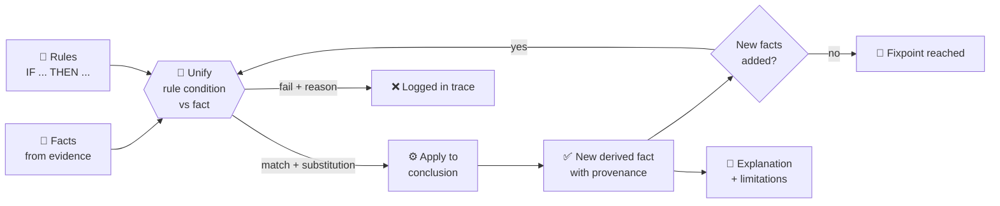

<div align="center">

```
 __  __ __   __ ___ _____ ___ ___ __   __ __  __ ___ _  _ ___
|  \/  |\ \ / // __|_   _| __| _ \\ \ / /|  \/  |_ _| \| |   \
| |\/| | \ V / \__ \ | | | _||   / \ V / | |\/| || || .` | |) |
|_|  |_|  |_|  |___/ |_| |___|_|_\  |_|  |_|  |_|___|_|\_|___/
```

# 🕵️ MysteryMind: AI Logic Detective

### *Every clue has a story. Every conclusion needs a reason.*

**A rule-based symbolic AI that solves fictional crimes with real unification and forward chaining.**

[](https://mysterymind-static.onrender.com/)
[](#how-it-works)
[](#unification-in-action)


**[🎬 Live Demo](#live-demo)** · **[🧠 How It Works](#how-it-works)** · **[⚡ Quick Start](#quick-start)** · **[🚀 Deploy](#deploy-it)** · **[📁 Structure](#project-structure)**

</div>

---

## 🔍 What is this?

**MysteryMind** is an interactive detective workspace built for an **AI & Expert Systems (AIES)** mini project. It extends the classic **Unification Algorithm** into a full investigation platform.

You give it **facts**, **clues** and **logical rules**. It uses **structural unification + forward chaining** to derive conclusions, and then it shows you *exactly* how it got there, step by step.

> 🧪 **It is not a chatbot.** There is no language model, no API and no server. Every conclusion is computed in your browser by a symbolic reasoning engine you can read in `src/engine.js`.

---

## ✨ Features

| | Feature | What it does |
|---|---|---|
| 🧩 | **Real unification engine** | Structural matching with a substitution map, occurs check, arity check and nested terms |
| ⛓️ | **Forward-chaining inference** | Multi-step rules, one consistent substitution across conditions, duplicate prevention, fixpoint detection |
| 🔬 | **Explainable AI** | Every derived fact shows its rule, matched facts, substitution, what it proves and what it does *not* prove |
| 🕹️ | **Step-through reasoning lab** | Watch the engine try each candidate fact and see `X → amit` happen live |
| 🗂️ | **5 built-in fictional cases** | Different reasoning patterns: access, permissions, attribution, causality, routes |
| 🛠️ | **Case Builder** | Create your **own** case with people, evidence, facts and rules, then run the engine on it |
| 🧪 | **Custom Lab** | Type your own terms, facts and rules. Add and remove facts and rerun |
| 🔎 | **Global search (Ctrl+K)** | Searches cases, evidence, suspects, statements, timeline and facts, plus structured quick queries |
| 📌 | **Evidence board** | Zoomable corkboard with red-string links built only from real data |
| 🕰️ | **Timeline** | Conflicts and missing information are flagged only where the record supports it |
| 📄 | **Report generator** | One-click investigation report from the actual inference results |
| 🎨 | **Noir detective UI** | Police tape, thumbtacks, polaroids, spotlight and film grain |

---

<a id="live-demo"></a>

## 🎬 Live Demo

🔗 **https://mysterymind-static.onrender.com/**

> **30-second tour**
> 1. Click **Run AI Reasoning Demo** on the first screen.
> 2. Hit **Next Step** and watch rule `R1` unify `has_key(X, lab)` with `has_key(amit, lab)`.
> 3. Click a derived fact to open its full explanation chain.
> 4. Open **Custom Lab** and try **Repeated-variable failure** or **Occurs check**.
> 5. Open **Case Builder** and solve a case of your own.

---

<a id="how-it-works"></a>

## 🧠 How the brain works



**Forward chaining loop**

1. Read the initial facts and the rules.
2. For each rule, **unify** every condition with the facts, carrying **one substitution** through all conditions.
3. Apply the substitution to the conclusion. Keep it only if it is **ground and new**.
4. Store **provenance**: the rule, the facts used and the substitution.
5. Repeat until a full round adds nothing (**fixpoint**).

---

<a id="unification-in-action"></a>

## 🧩 Unification in action

| Term 1 | Term 2 | Result |
|---|---|---|
| `has_key(X, lab)` | `has_key(amit, lab)` | ✅ `X = amit` |
| `present(X, lab)` | `present(rahul, lab)` | ✅ `X = rahul` |
| `has_key(X, lab)` | `present(amit, lab)` | ❌ Predicate names differ |
| `owns(X, X)` | `owns(amit, rahul)` | ❌ Repeated variable `X` cannot equal two different constants |
| `located(X, room(Y))` | `located(amit, room(lab))` | ✅ `X = amit`, `Y = lab` |
| `p(X, f(X))` | `p(Y, Y)` | ❌ Occurs check failed |

**Multi-step inference**

```text
R1: IF has_key(X, lab) AND present(X, lab)    THEN can_access(X, lab)
R2: IF can_access(X, lab) AND present(X, lab) THEN could_enter(X, lab)

Facts:    has_key(amit, lab)   present(amit, lab)
Derived:  can_access(amit, lab)      <- R1, X = amit
          could_enter(amit, lab)     <- R2, X = amit
```

Rules can also use two built-in checks: `neq(A, B)` and `lt(A, B)`. They work on values that are already bound, for comparing times and spotting mismatches.

---

## 🗂️ The case files

| # | Case | Reasoning pattern |
|---|---|---|
| 001 | 💻 **The Missing Laboratory Laptop** | Access + presence + time comparison + conflicting statements |
| 002 | 🗝️ **The Locked Archive Room** | Group permissions, transitive containment, contradicted claims |
| 003 | 📄 **The Disappearing Project File** | Shared logins and attribution uncertainty, unresolved backup |
| 004 | ⚡ **The Midnight Power Failure** | Candidate causes, duplicate prevention, reported vs verified |
| 005 | 🏺 **The Museum Exhibit Mystery** | Recursive route reachability, displacement, access gaps |

> ⚖️ **Ethics rule built in:** access, presence or opportunity never equals guilt. A derived fact only means *the encoded conditions were met*, and the UI says what it does **not** establish.

---

## 🛠️ Case Builder: solve your own mystery

Open **Case Builder** in the sidebar to create a case of your own:

1. Fill in the title, people, evidence, facts and rules. Statements and timeline events are optional.
2. Write facts as `predicate(constant, constant)`, for example `present(meera, canteen)`.
3. Write rules as `R1: IF has_key(X, cashbox) AND present(X, canteen) THEN can_open(X, cashbox)`.
4. Click **Create case and open it**. Your case gets dossiers, an evidence vault, a timeline, an evidence board, the reasoning lab and a report, just like the built-in ones.

Use **Fill with an example** to load a ready-made case. Your cases are saved in your browser.

---

<a id="quick-start"></a>

## ⚡ Quick Start

**Just want to try it?** Open the live site: **https://mysterymind-static.onrender.com/**

**Want the code?**

```bash
git clone https://github.com/HARSHIT715/mysterymind.git
cd mysterymind
```

Then open `index.html` in your browser (double-click it, or use VS Code's *Open with Live Server*).

No `npm install`. No build step to run it.

### 🛠️ Editing the code

```bash
# edit anything inside /src, then rebuild the single-file site:
node build.js          # works on Windows, Mac and Linux
# or: npm run build   /   sh build.sh
```

---

<a id="deploy-it"></a>

## 🚀 Deploy it

<details>
<summary><b>🟣 Render (free static site)</b></summary>

1. Push this repo to GitHub.
2. Go to [render.com](https://render.com) > **New +** > **Static Site** > select the repo.
3. **Build Command:** leave empty (or `echo ok`). **Publish Directory:** `.`
4. Click **Create Static Site**. Every `git push` redeploys automatically.

</details>

<details>
<summary><b>🐙 GitHub Pages</b></summary>

Repo **Settings** > **Pages** > *Deploy from a branch* > `main` / `(root)`.
Your site will be at `https://HARSHIT715.github.io/mysterymind/`.

</details>

---

<a id="project-structure"></a>

## 📁 Project structure

```text
mysterymind/
├── index.html        # the full website (everything inlined)  <- deploy this
├── build.js          # rebuilds index.html from src/ (cross-platform)
├── build.sh          # same, for Mac/Linux
├── render.yaml       # optional Render config
├── package.json      # optional npm shortcuts
└── src/
    ├── engine.js     # 🧠 unify(), occurs check, forward chaining, provenance
    ├── data.js       # 🗂️ the 5 fictional cases (facts, rules, evidence...)
    ├── ui1.js        # 🖥️ helpers, state, pages (cases, suspects, evidence, timeline)
    ├── ui2.js        # 🖥️ board, reasoning lab, report, search, Case Builder
    ├── style.css     # 🎨 base design system
    ├── theme.css     # 🕵️ noir detective theme
    └── head.html     # document head and fonts
```

---

## 🧰 Tech stack

`HTML` · `CSS` · `Vanilla JavaScript` · **Zero dependencies** · **Zero backend** · **Zero API keys**

---

## ⚠️ Honest limitations

- It is a **symbolic, rule-based** system. It does not understand free-form natural language. Facts and rules use a small, documented syntax.
- Text search is plain keyword matching and is **kept separate** from logical inference.
- Derived facts show that **encoded conditions were met**. They do **not** prove what actually happened.
- All people, places and incidents are **fictional**.
- Cases you create are saved in your own browser (`localStorage`), per site address.

---

## 🗺️ Roadmap

- [ ] Export and import cases as JSON
- [ ] Backward chaining and "why not?" explanations
- [ ] Negation as failure
- [ ] Printable PDF reports
- [ ] More built-in cases

---

## 🎓 Academic context

Built as an **AI & Expert Systems** mini project covering: **Knowledge Representation · Unification · Rule-Based Inference · Forward Chaining · Explainable AI**.

---

<div align="center">

### 🔎 Case status: **OPEN**

**If MysteryMind helped you, drop a ⭐ on the repo.**

*Made with 🕵️ and a lot of coffee.*

</div>
